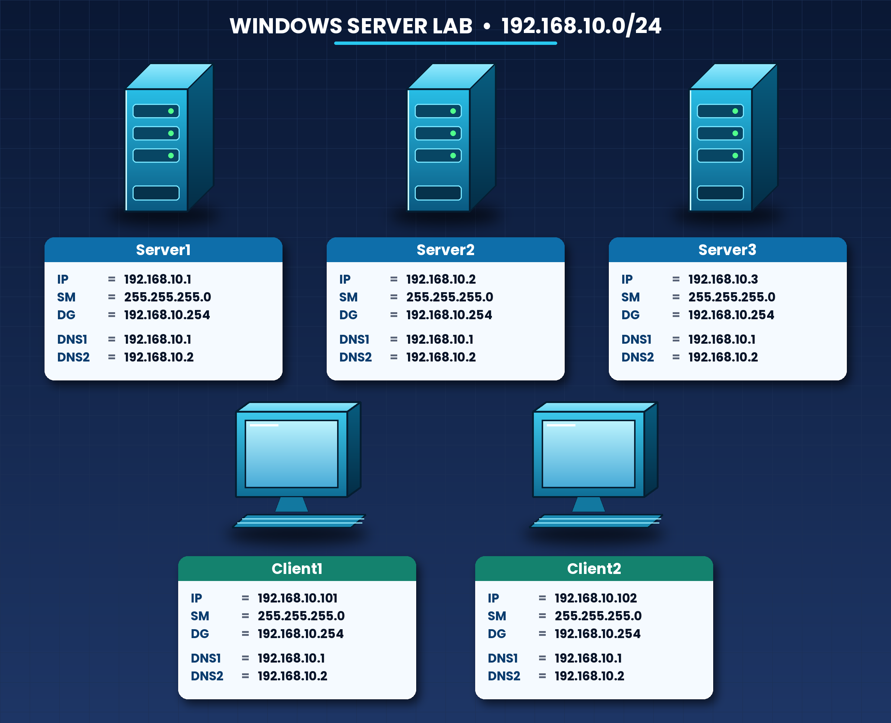

# Windows Server Administration – Practical Learning Journey

## 📌 Project Overview

Welcome to my Windows Server Administration Practical Learning Journey!

This repository documents my hands-on learning and practical experience with Windows Server 2016, covering fundamental to advanced server administration concepts.

Throughout this journey, I will explore, configure, test, and document different Windows Server technologies in a virtual lab environment.

The primary goal of this project is to develop practical skills in Windows Server Administration, understand enterprise server infrastructure, and gain hands-on experience with server deployment, management, security, networking, virtualization, storage, and high availability.

All topics will be documented with step-by-step configurations, commands, screenshots, lab topologies, and practical results.

## 🎯 Project Objectives

- Understand Windows Server installation and configuration.
- Build and manage a virtual server infrastructure.
- Configure Active Directory and Domain Services.
- Manage users, groups, organizational units, and Group Policies.
- Implement network services such as DNS and DHCP.
- Configure file sharing, permissions, and server security.
- Explore advanced Windows Server roles and features.
- Understand virtualization and Hyper-V management.
- Configure storage solutions and iSCSI connectivity.
- Explore Failover Clustering and High Availability.
- Document practical configurations and troubleshooting experiences.

## 🖥️ Lab Topology

The entire project will be practiced in a virtual lab environment.

The lab topology diagram below represents the virtual infrastructure used throughout this learning journey.

## 🧪 Lab Environment

| Component | Details |
|---|---|
| Server Operating System | Windows Server 2016 |
| Virtualization Platform | Hypervisor-based Virtual Lab |
| Virtual Machines | Multiple Windows Server and Client VMs |
| Network Configuration | Virtual Network Adapters |
| Server Roles | AD DS, DNS, DHCP, File Services, etc. |
| Administration Tools | Server Manager, PowerShell, CMD |

*The actual lab configuration and virtual machine specifications may vary depending on the practical task.*

## 📚 Topics Covered

### 1. Windows Server Fundamentals
- Windows Server 2016 Installation
- Initial Server Configuration
- Server Manager
- Server Roles and Features
- Standard and Datacenter Editions

### 2. Virtualization and Hyper-V
- Understanding Virtualization
- Creating and Managing Virtual Machines
- Virtual Hard Disks
- Virtual Network Adapters
- Virtual Switches
- Hyper-V Configuration
- Hyper-V Server Management

### 3. Active Directory Domain Services (AD DS)
- Understanding Active Directory
- Domain and Domain Controller
- Installing AD DS
- Creating a New Domain
- Domain Joining
- Additional Domain Controller (ADC)
- Read-Only Domain Controller (RODC)
- Member Server Configuration
- Domain Tree and Child Domain
- Forest and Forest Trust
- Domain Controller Options

### 4. Active Directory Management
- Organizational Units (OU)
- User Account Management
- Group Management
- Group Types and Scopes
- Group Policy Management
- Password Policies
- Access Control

### 5. Network Services
- Domain Name System (DNS)
- Dynamic Host Configuration Protocol (DHCP)
- DNS Configuration and Management
- DHCP Scope Configuration
- DHCP Server Management

### 6. File Services and Server Security
- Windows File System
- SMB File Sharing
- File and Folder Permissions
- NTFS Permissions
- File Server Resource Manager (FSRM)
- Distributed File System (DFS)
- Dynamic Access Control (DAC)
- BitLocker Drive Encryption
- Windows Server Firewall
- Kerberos Authentication

### 7. Server Networking and Virtualization
- NIC Teaming
- Hyper-V Virtual Networking
- Virtual Switch Management
- Server Network Configuration

### 8. Storage Management
- Direct Attached Storage (DAS)
- Network Attached Storage (NAS) concepts
- Storage Area Network (SAN)
- iSCSI Configuration
- RAID
- Storage Pools
- Storage Spaces Direct (S2D)

### 9. Failover Clustering and High Availability
- Failover Cluster Manager
- Failover Clustering
- Cluster Network Configuration
- Cluster Storage
- Split-Brain Concept
- High Availability
- Cluster Management

## 📂 Repository Structure

This repository is organized into separate folders based on technologies and practical lab topics.

Each topic contains relevant documentation, commands, screenshots, configurations, and learning outcomes.

## 📸 Documentation and Resources

For each practical lab, I aim to include:

- Step-by-step configuration guides
- PowerShell and CMD commands
- Important screenshots
- Configuration results
- Troubleshooting notes
- Also YouTube video 

## 🎥 YouTube Playlis

- YouTube: [My YouTube Channel](YOUR_YOUTUBE_LINK)

## 📈 Project Progress

This is an ongoing learning project. New practical labs, configurations, and documentation will be added continuously.

## ⚠️ Disclaimer

This repository is created for educational purposes and represents my personal learning and practical experience.

All configurations and demonstrations are performed in a virtual lab environment. The content is based on my own practice, experimentation, and documentation.

## 🤝 Connect With Me

I share my technical learning journey, practical demonstrations, and project updates through my social platforms.

Thank you for visiting my repository!

**Learn • Practice • Document • Improve**
